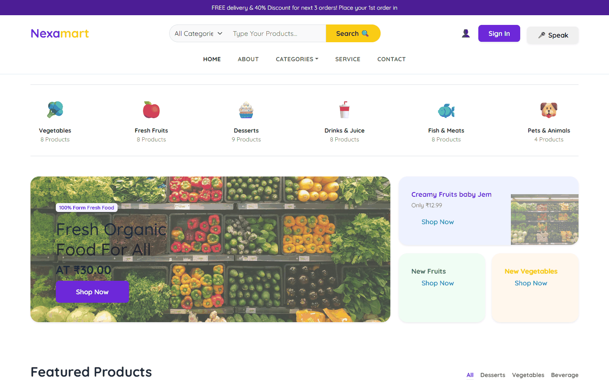
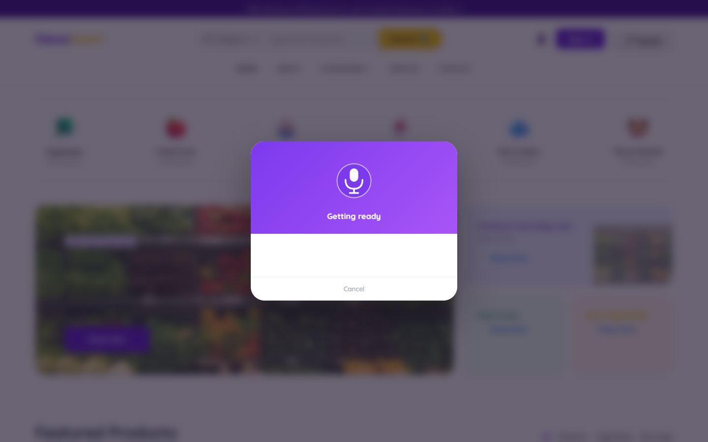
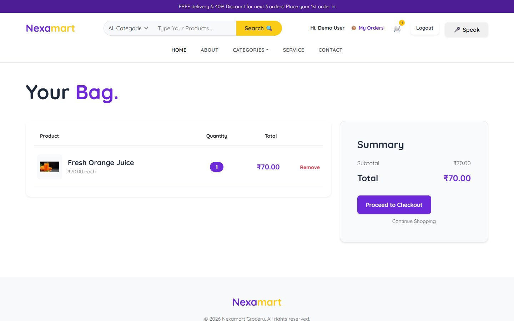
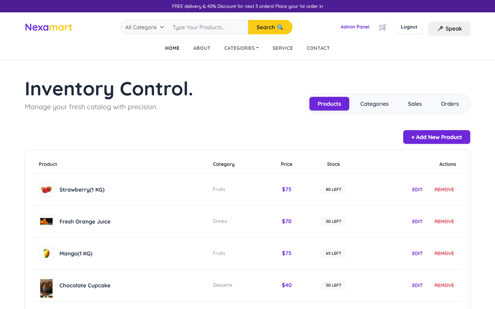

# NEXATMART

**An online grocery store you can shop entirely by voice, made for blind and partially sighted customers.**

[Case study on niranjand.in](https://www.niranjand.in/projects/nexatmart)



## What it is

Most online grocery stores are built around scanning pages and clicking small buttons, which shuts out people who can't see the screen well. NEXATMART lets you shop by speaking. Press **Speak**, say what you want, and the store finds it, reads back the name and price, adds it to your basket and takes you through checkout, asking for a spoken yes or no before it places the order.

Voice is the main way in, not an add-on: it understands everyday phrasing, copes with misheard words, and also recognises common Tamil and Hindi words for groceries typed in English letters (for example *thakkali* for tomato, *vengayam* for onion). A normal click-and-browse store and an admin panel sit alongside it.

## Features

- **Shop by voice.** Ask for a product ("can I please have some fresh tomatoes"), a category ("show me fruits"), the cheapest or most premium item, or everything in stock.
- **Forgiving matching.** Misheard or misspelled speech still finds the right product; weaker matches come back as three "did you mean" options.
- **Follow-up by voice.** After each answer the assistant listens again for replies like "add that", "the second one", "my cart", "my orders", "checkout", "go home" or "log out".
- **Spoken confirmation before checkout.** It reads back everything in the basket and waits for a spoken yes or no.
- **Everything is spoken, including errors.** A blocked microphone, silence, a network failure or an out-of-stock item is said out loud, and the assistant either listens again or closes.
- **Tamil and Hindi words** for common groceries, and Tamil phrases for commands such as *cart parunga* (show my cart) or *bill podu* (checkout).
- **A regular store too.** Categories, search, product pages, a cart, checkout and order history.
- **Admin panel.** Add, edit and remove products and categories, manage orders and their status, and a daily sales report of delivered orders. Deleting a product requires a one-time code sent by email.

## Screenshots

| | |
|---|---|
|  |  |
| The voice assistant opens over the page | The bag, ready for a spoken checkout |



## How it works

NEXATMART is an ASP.NET Core MVC app (C#, Razor views) with Entity Framework Core on SQLite. The voice front end is one script, `wwwroot/js/voiceassistant.js`, built on the browser's Web Speech API. The language understanding runs on the server in `Controllers/VoiceController.cs`, with no external NLP service or library.

```text
 Browser                                                    Server (ASP.NET Core MVC)
 ───────                                                    ─────────────────────────
 "Speak" ─► SpeechRecognition (en-US, up to 6 alternatives,
            each with a confidence score)
              │ top guess < 25% confidence? ask again (max 2 retries)
              │ local intent? (cart, checkout, orders, home, logout,
              │   "add that", "the second one" …) ─► act directly
              ▼
        POST /Voice/search  { speech, alternatives[], confidences[] } ─► VoiceController.Search
                                                                   1. delivery / checkout questions
                                                                   2. category keywords
                                                                   3. cheapest / premium / "what's in stock"
                                                                   4. fuzzy product match (below)
              ◄──────────── JSON: found product / suggestions / message
              │
        speechSynthesis reads the result, then listens for a follow-up
        "add that" ─► POST /Cart/AddToCartAjax ─► session cart
```

### Matching speech to products

`VoiceController` turns noisy speech into a product in a few steps:

1. **Try every guess.** The browser's primary transcript and its alternatives are tried in order of confidence.
2. **Normalise.** Filler phrases ("can I please have some", longest first), plural and suffix forms (*berries → berry*, *tomatoes → tomato*) and quality words (*fresh*, *organic* …) are stripped.
3. **Expand synonyms.** A dictionary maps romanised Tamil and Hindi words and English variants to product names, matched on whole words so *pea* doesn't fire inside *peach*.
4. **Score with n-grams.** Every 1 to 4 word window of what was heard is compared against every product name, so "I want fresh tomato today" still lands on *tomato*.
5. **Combine three string metrics.** Each word pair is scored with **Jaro-Winkler** (50%), normalised **Levenshtein** distance (30%) and **Soundex** (20%, for words that sound alike but are spelled differently). These are written by hand in the controller. The composite score also uses exact-containment shortcuts, a phrase-level comparison and a token-coverage bonus.
6. **Decide.** A strong match (score below 0.32) is returned as the product, in stock or not. A weaker one returns up to three suggestions under 0.62 as "did you mean" options.

### The voice loop on the client

- `rec.maxAlternatives = 6`, and the alternatives are sent to the server with their confidence scores.
- If the top guess is under **25% confidence**, the assistant asks the customer to repeat it, up to **two** retries; `no-speech`, `not-allowed` and `network` errors each get their own spoken message.
- An intent map handles navigation and follow-ups in the browser without a server round trip, in English and romanised Tamil.
- The last results are kept as context, so "the second one" or "add that" refer to what was just read out.
- Every state (listening, thinking, adding to cart, retry, network error) has its own animated status in the overlay as well as a spoken line.

### Data and sessions

- Models: `User`, `Category`, `Product`, `Order` and `OrderDetail`. Prices are `decimal(18,2)`; email and phone number are unique.
- `Program.cs` calls `EnsureCreated()` on start, and `ApplicationDbContext` seeds categories, sample products and two demo accounts. A ready-made `grocery.db` is included in the repository.
- The cart and the signed-in user live in the ASP.NET Core session (30-minute idle timeout, HTTP-only cookie). Checkout turns the session cart into an `Order` with `OrderDetail` rows.
- Admin pages check the session role on every action.

### Honest status

Voice was the hard part and got most of the time; some of the account plumbing is simpler than a real store needs. Sign-in uses a phone number and password checked directly against the database, without password hashing, so this is a demo, not something to run with real customer accounts. The next steps are moving sign-in to ASP.NET Core Identity and trying the browser's Tamil and Hindi speech recognisers, since the English recogniser only catches those words when it happens to spell them the way the synonym list expects.

## Tech stack

| Area | Technology |
|---|---|
| Back end | C#, ASP.NET Core MVC (.NET 10), Entity Framework Core 10 |
| Database | SQLite (`grocery.db`) |
| Front end | Razor views, Bootstrap 5.3, Animate.css, vanilla JavaScript |
| Voice | Web Speech API: `SpeechRecognition` and `speechSynthesis` |
| Matching | Hand-written Jaro-Winkler, Levenshtein and Soundex scoring with n-gram windows and a synonym dictionary |

## Getting started

**Prerequisites:** the [.NET 10 SDK](https://dotnet.microsoft.com/download) (the project targets `net10.0`) and a browser with speech recognition (Chrome or Edge). Speech recognition needs a secure context, so use `localhost` or HTTPS.

```bash
git clone https://github.com/Niranjan266/NEXATMART.git
cd NEXATMART
dotnet restore
dotnet run
```

Open the URL shown in the terminal (the `http` launch profile uses http://localhost:5050). The SQLite database is created and seeded on first run if it doesn't exist; the connection string is `DefaultConnection` in `appsettings.json`.

Allow microphone access when the browser asks, then press **Speak** in the header.

### Demo accounts

Sign in with a **phone number** and password:

| Role | Phone number | Password |
|---|---|---|
| Admin | `0000000000` | `admin123` |
| Customer | `1234567890` | `user123` |

### Things to try

- "Show me fruits" → "the second one" → "add that"
- "What's the cheapest thing you have?"
- "Thakkali" or "vengayam"
- "What's in my cart?" → "checkout" → "yes"

## Project structure

```text
NEXATMART/
├── Controllers/
│   ├── VoiceController.cs     # POST /Voice/search: normalisation, synonyms, fuzzy scoring
│   ├── HomeController.cs      # storefront, search, categories, product details
│   ├── CartController.cs      # session cart, AJAX add, checkout
│   ├── AccountController.cs   # register, login, order history
│   └── AdminController.cs     # products, categories, orders, sales report
├── Data/ApplicationDbContext.cs   # EF Core context, unique indexes, seed data
├── Models/                    # User, Category, Product, Order, OrderDetail
├── Views/                     # Razor views: Home, Cart, Account, Admin, Shared/_Layout
├── wwwroot/
│   ├── js/voiceassistant.js   # speech in/out, intents, retries, context, overlay
│   └── css/site.css
├── Program.cs                 # services, session, EnsureCreated, routing
├── appsettings.json           # SQLite connection string
├── grocery.db                 # included SQLite database
├── OnlineGroceryShop.csproj
└── online_grocery--main.sln
```

## License

Released under the Apache License 2.0 — see [LICENSE](LICENSE).

## Author

Built by Niranjan D — [niranjand.in](https://www.niranjand.in) · [GitHub](https://github.com/Niranjan266) · [LinkedIn](https://www.linkedin.com/in/niranjan266)
